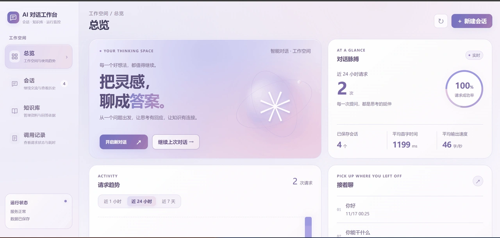
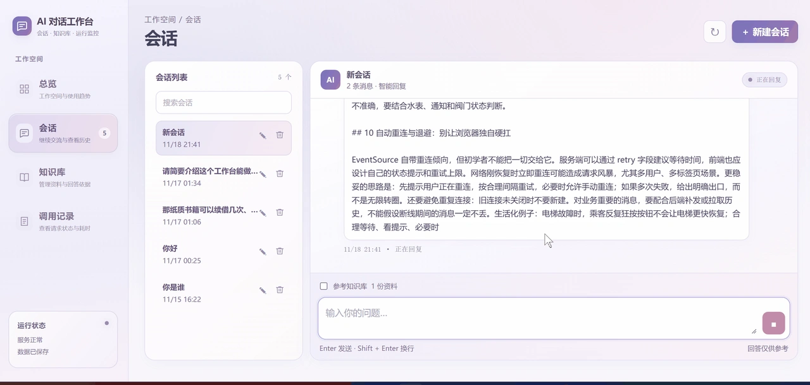
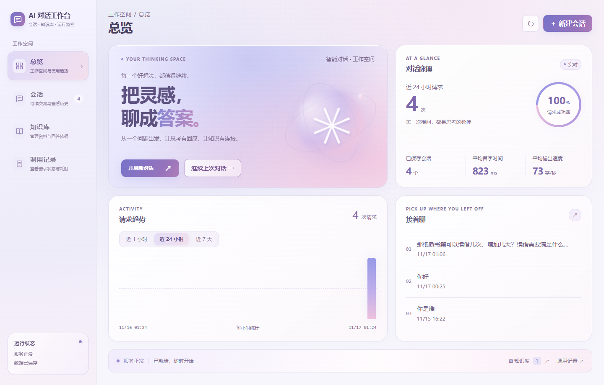
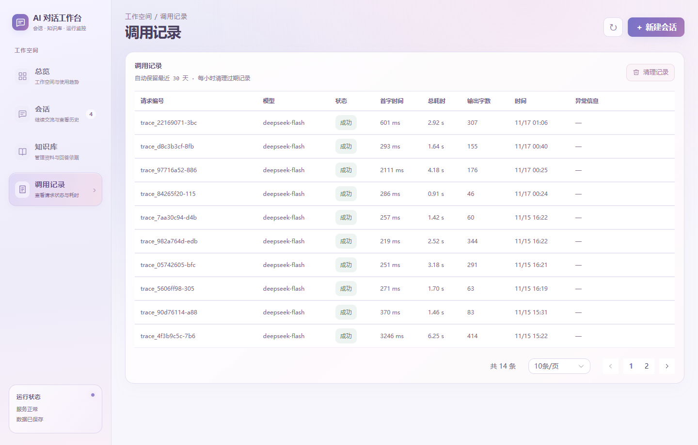

# AI 流式对话工作台

围绕流式问答、多轮会话和知识库引用构建的对话工作台。用户可以新建会话、继续追问、停止回复，通过独立链接重新打开历史对话；调用记录和首页指标来自实际请求。

> 支持单用户本地运行。未配置模型服务时使用明确标注的演示回复；模型密钥只保存在服务端。目前没有账号权限隔离，不应将 API 直接开放到公网。

[功能](#功能) · [架构](#架构) · [工程实现](#工程实现) · [技术栈](#技术栈) · [本地运行](#本地运行) · [验证](#验证)

## 实际操作

核心流程：**新建会话 → 流式回答 → 多轮追问 → 停止生成 → 打开历史会话**。开启“参考知识库”后，可查看本次回答使用的资料片段。

下面是工作台操作演示。文件选择片段已加速，提问与回答保持原速。



**长回答回看与返回最新消息**

回答生成结束后，向上回看内容，再点击“回到最新消息”平滑返回底部。以下片段约 12 秒，保持原操作速度。



不配置模型密钥也可以按下文启动项目，体验会话与流式交互。

<details>
<summary>更多界面：总览与调用记录</summary>

### 工作空间总览

查看会话数量、请求趋势、近期会话和服务状态。



### 调用记录

查看每次请求的状态、首字时间、总耗时和输出字数，支持分页及确认后清理。



</details>

截图来自本地运行页面，指标随实际请求变化，不代表性能基准测试结果。


## 功能

| 模块 | 当前实现 |
| --- | --- |
| 总览 | 会话数、近 24 小时请求、首字时间、成功率和输出速度；请求趋势支持近 1 小时、24 小时与 7 天 |
| 会话 | 新建、搜索、重命名、删除、多轮上下文；具体会话通过 `/sessions/:sessionId` 定位，支持刷新和前进后退 |
| 流式回复 | SSE 增量接收、自适应逐字展示、主动停止；在底部时跟随输出，翻看历史时暂停跟随 |
| 知识库 | 导入 TXT / Markdown 或粘贴文本，切分、检索并展示来源片段；支持删除资料 |
| 异常恢复 | 离线提示、联网后检查服务、首段等待与流停滞超时、模型错误分类、可重试失败的手动重试 |
| 调用记录 | 请求编号、模型、状态、首字时间、耗时、输出字数及异常信息；分页展示，自动保留 30 天，支持确认后清理 |

## 架构

```text
浏览器：Vue 3 / TypeScript / Vue Router / Pinia
               │ REST / SSE
               ▼
业务服务：Express / TypeScript
  ├─ 会话与调用记录 ── MySQL（可选）或本机 JSON
  ├─ 知识资料与索引 ── 本机 JSON
  └─ LangChain.js ───── 对话模型 / 可选 Embeddings 服务
```

浏览器不直接连接模型或数据库。服务端读取最近 12 条历史消息，按需检索资料，再将上下文交给模型，通过 SSE 返回事件。成功回复保存为会话消息，失败和取消也记录调用状态。

只配置对话模型时，知识库使用关键词匹配；另配 Embeddings 服务后使用向量相似度检索。两种模式会在来源区明确区分，不能将关键词匹配描述成语义向量检索。知识资料和向量索引目前保存在本机，不依赖外部向量数据库。

## 工程实现

### 接收流式数据与逐字展示分开处理

模型可能一次返回较长的文本片段。直接把每个片段写进界面，视觉上会出现整段跳出；固定放慢每个字，又会让长回答等待过久。

服务层用 `fetch` 读取响应流，保留尚未收齐的 SSE 事件，处理 `meta`、`sources`、`token`、`done` 和 `error`。Pinia 中的会话状态接收文本片段，将其放入展示队列，再按已接收字数和队列积压情况调整展示速度。收到完成事件后，仍需等待队列展示结束，才退出回复状态。

主动停止会取消请求并清理定时器；若模型已经完成、仅前端尚未展示完，会提示“完整回复已保存”。调用记录中的耗时来自服务端，不包含前端人为放慢展示的时间。

- 实现：[SSE 解析与连接管理](frontend/src/services/api.ts)、[会话状态与展示队列](frontend/src/stores/chat.ts)。
- 验证：[接口主流程](backend/tests/api.test.js)与[模拟模型测试](backend/tests/provider.test.js)覆盖演示流、取消、鉴权失败、上游断连和并发流。浏览器逐字展示另经过本地回归检查，当前未整理为仓库内一键执行的端到端测试。

### 会话链接、异步加载和阅读位置保持一致

具体会话使用 History 路由定位，页面监听 URL 中的会话 ID 加载历史。刷新或前进后退时，打开的内容与地址一致；加载中和会话不存在时提供对应状态，禁止向未就绪的会话发送消息。

快速切换时，旧请求可能晚于新请求返回。会话加载和流式回复分别使用递增版本号，只有当前版本可以更新对应状态。离开页面时取消流式请求，并使未完成的加载结果失效。

滚动不再随着每次文本更新无条件跳到底部：接近底部时跟随输出，向上滚动时暂停，点击“回到最新消息”后恢复跟随。

- 实现：[路由](frontend/src/router/index.ts)、[会话加载](frontend/src/stores/chat.ts)、[会话页与滚动](frontend/src/components/ConversationsPage.vue)。
- 验证：本地浏览器检查覆盖会话链接直接访问、刷新、前进后退、不存在会话，以及长回复期间向上阅读和恢复跟随。自动化回归脚本尚未随源码交付，不能据此声称已有完整端到端测试体系。

### 连接失败时结束等待，让用户决定是否重试

普通接口使用 Axios 超时和统一错误提示。流式请求另设首段等待 60 秒、输出停滞 45 秒和总时长 180 秒的上限，避免连接未关闭但长期没有输出时一直等待。连接结束却没有完成事件，也会标记回复未完成。

断网时保留已经显示的内容；恢复联网后检查服务，清除已恢复的服务连接错误，不自动重发问题。可重试的失败回复提供“重新生成回复”，离线或正在生成时禁用。模型 SDK 的隐式重试也已关闭，避免用户不知情时重复请求。

- 实现：[错误分类](frontend/src/services/errors.ts)、[请求与超时管理](frontend/src/services/api.ts)、[工作区恢复](frontend/src/stores/workspace.ts)、[模型错误分类](backend/src/model-errors.ts)。
- 验证：[模型失败测试](backend/tests/model-errors.test.js)及[模拟模型测试](backend/tests/provider.test.js)；浏览器断网、恢复、停滞超时和手动重试经过本地模拟检查，测试时缩短等待上限，不消耗真实模型额度。

## 技术栈

| 层次 | 技术 | 用途 |
| --- | --- | --- |
| 前端 | Vue 3、TypeScript、Vite、Vue Router | 页面、History 路由和按页面加载 |
| 状态与组件 | Pinia、Element Plus、CSS | 会话与工作区状态，按需使用弹窗、表格、分页和通知 |
| 请求 | Axios、Fetch、AbortController、SSE | 业务请求、流式接收、取消与超时 |
| 服务端 | Node.js、Express、TypeScript、Zod | 业务接口、参数校验和 SSE 转发 |
| 模型与检索 | LangChain.js、兼容 Chat Completions / Embeddings 的接口 | 上下文问答、可选向量化与资料检索 |
| 存储 | 可选 MySQL、本机 JSON | 会话、消息、调用日志和知识资料 |
| 验证 | TypeScript 构建、Node 测试 | 类型检查、接口与模拟模型回归 |

## 本地运行

需要 Node.js 20 或更高版本。以下命令在项目根目录的 PowerShell 执行：

```powershell
npm ci
Copy-Item backend/.env.example backend/.env
npm run dev
```

默认访问 `http://localhost:5173`，API 为 `http://127.0.0.1:3000`。未配置模型和 MySQL 时，可以使用演示回复和本机存储完成主流程。

配置真实模型时，在 `backend/.env` 填写：

| 配置 | 用途 |
| --- | --- |
| `CHAT_API_KEY`、`CHAT_MODEL`、`CHAT_BASE_URL` | 对话模型；模型名以服务实际支持的名称为准 |
| `EMBEDDING_API_KEY`、`EMBEDDING_MODEL`、`EMBEDDING_BASE_URL` | 可选向量服务；留空使用关键词匹配 |
| `MYSQL_HOST`、`MYSQL_PORT`、`MYSQL_USER`、`MYSQL_PASSWORD`、`MYSQL_DATABASE` | 可选数据库；不配置连接时使用本机 JSON |

使用 MySQL 时，填写连接配置后运行：

```powershell
npm run db:init -w backend
```

已有旧版数据库参照 [结构迁移](database/migrate_2.sql)。如需迁移旧的本地会话，运行 `npm run db:migrate-local -w backend`；迁移会保留原文件。

端口由 `backend/.env` 的 `PORT` 和前端环境变量 `FRONTEND_PORT` 决定；更换端口时同步设置 `API_PROXY_TARGET`、`FRONTEND_ORIGIN`。数据默认写入 `backend/data/`，不进入版本库。生产构建使用 `npm run build`，启动已构建的 API 使用 `npm start`；静态前端需单独托管，并配置 [History 路由回退](docs/history-routing.md)。

## 验证

```powershell
npm run build
npm test
```

当前包含 10 项后端测试，覆盖会话与流式主流程、模型鉴权失败、上游断连、并发流、向量索引、请求趋势边界、日志过期清理和手动清理。模拟模型与向量服务不需要真实密钥，也不消耗模型额度。

源码在独立目录完成过 `npm ci`、构建、测试，以及无密钥演示模式的浏览器验证。检查记录见 [开源前检查](docs/release-readiness.md)。这些检查不等同于公网压力测试或生产验收。

## 当前边界

- 单用户本地工作台，尚无账号权限隔离、生产级限流和模型预算控制。
- 知识库支持 TXT / Markdown，不包含 PDF 解析；本机 JSON 索引不适合多实例共享。
- 向量检索通过模拟 Embeddings 服务验证，尚未完成真实向量服务联调。
- 没有断点续传；失败后手动重试是一次新请求，可能产生额外模型费用。
- 清理调用记录会影响对应时间段的首页统计，但保留会话消息与知识库。

## 许可证

项目自有源码采用 [MIT License](LICENSE)。第三方依赖适用各自的许可证。使用前请阅读 [安全与使用范围](SECURITY.md)。
